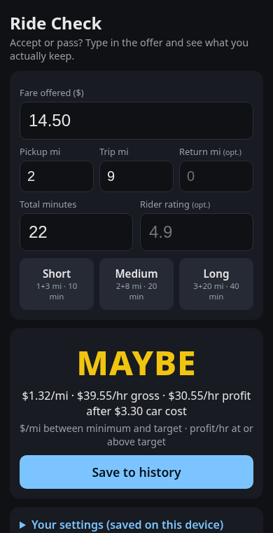
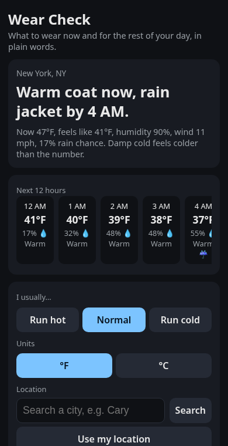
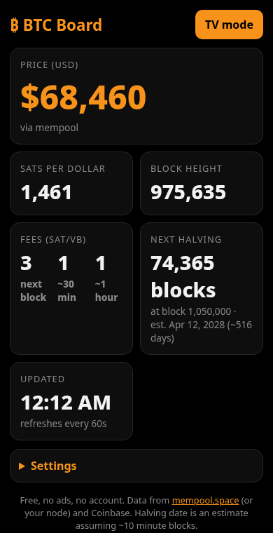
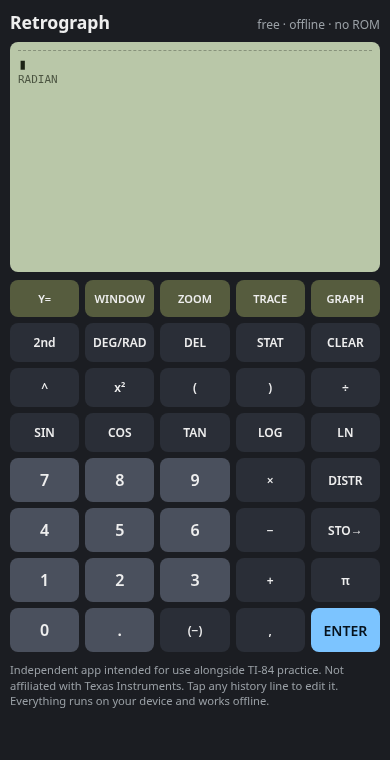

# Crave Lab

**Building the software people crave.**

Small, free web apps by Matthew "Frog" Finley, each one built from real posts where people said they wish a tool existed.

Every app lives in its own folder and is served at `https://m-fin.github.io/crave-lab/<app-name>/`.

## Apps

- [Ride Check](https://m-fin.github.io/crave-lab/ride-check/): accept or pass a rideshare offer from its fare, miles, and minutes ($/mile, $/hour, and profit after car costs).
- [Wear Check](https://m-fin.github.io/crave-lab/wear-check/): what to wear now and over the next 12 hours, in one sentence, from the Open-Meteo forecast.
- [BTC Board](https://m-fin.github.io/crave-lab/btc-board/): ad-free Bitcoin board with price, fees, block height, and a halving countdown, including a fullscreen TV mode.
- [Retrograph](https://m-fin.github.io/crave-lab/calc/): calculator with stat tests, distributions, and graphing. Not affiliated with Texas Instruments.

## Screenshots

<p>




</p>

## Run tests locally

The calculator checks in `calc/test.js` (stats, parser, and graphing) run in plain Node. Nothing to install:

```bash
node calc/test.js
```

Each check prints `PASS` or `FAIL`. The process exits `0` when they all pass and `1` when any fail. The same command runs in GitHub Actions on pull requests and on pushes to `main`.

An accessibility check loads the landing page and all four apps in headless Chrome, at phone (390 px) and desktop
(1280 px) widths, and runs [axe-core](https://github.com/dequelabs/axe-core) (WCAG 2 A/AA and best practices).
Third-party API calls are stubbed, so it runs offline. It runs in CI too:

```bash
npm i --no-save puppeteer-core axe-core
node tools/a11y-check.mjs
```
